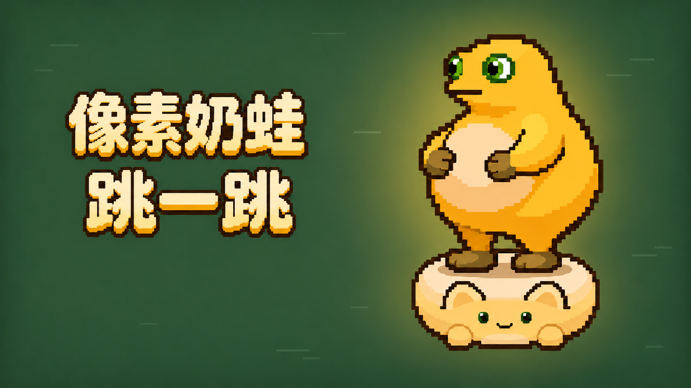
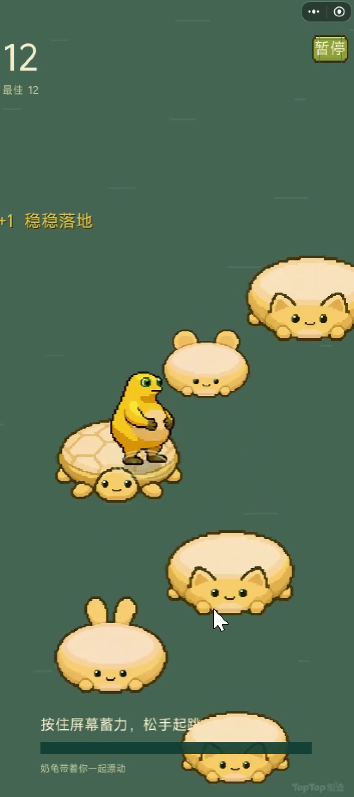
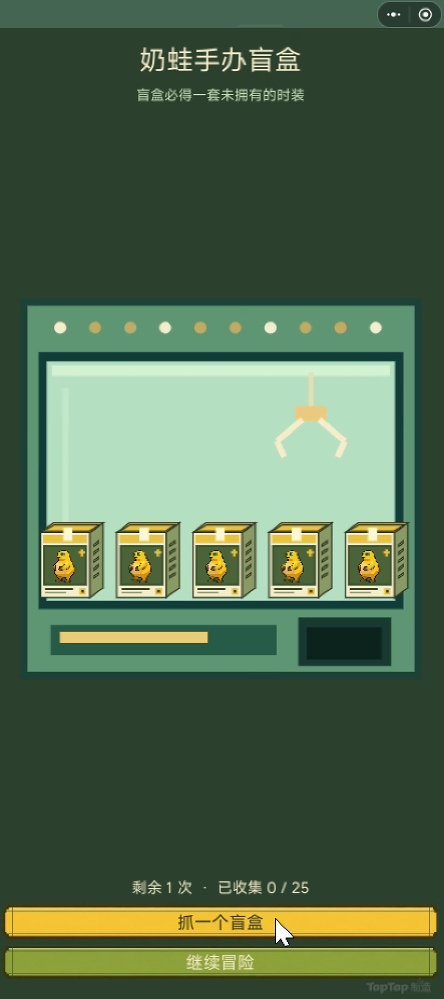
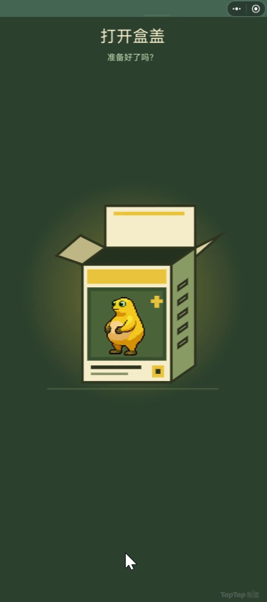
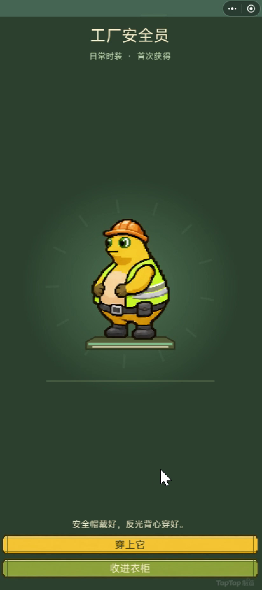

# 像素奶蛙跳一跳

按住蓄力，松手起跳。在大小不同的奶系动物浮台间前进；只有落水才结束一局，每次落水还能抓一次手办盲盒。

由 [NaiwaPixel](https://github.com/NaiwaPixel) 制作，使用 TapTap 制造官方工具与 UrhoX / Lua 5.4。当前源码版本 **0.4.1**。



**[TapTap 游戏页](https://www.taptap.cn/app/1077732) · [报告问题](https://github.com/NaiwaPixel/naiwa-jump/issues) · [开发与运行说明](docs/DEVELOPMENT.md)**

## 怎么玩

- 手机按住屏幕，电脑按住鼠标或空格，松开后跳跃。不显示预测落点。
- 普通落地得 1 分，连续落在平台中心可获得递增奖励。
- 奶龟浮台会漂动，奶鼠浮台会下沉，奶兔浮台给下一跳加成。
- 落水后可抓一次盲盒：撕封条、翻盖、升起黑色剪影，再揭晓时装。
- 25 套可收集时装分为日常、稀有、史诗和传说；集齐前不重复，只改变外观。
- 内置教程、暂停、声音开关、衣柜和 TapTap 原生最高分排行榜；落水后自动同步更高成绩。

| 跳跃 | 抓盲盒 | 开盒 | 时装揭晓 |
| --- | --- | --- | --- |
|  |  |  |  |

## 这份仓库包含什么

| 目录 | 内容 |
| --- | --- |
| `scripts/` | 游戏入口、跳跃、平台、界面、盲盒、存档、声音及排行榜代码 |
| `assets/` | 运行所需的角色、25 套时装、动物浮台、按钮、音频和字体 |
| `.project/` | 可移植的运行配置示例，不含工作室账号绑定 |
| `art/` | 图集坐标、碰撞轮廓、素材来源与 AI 生成提示词 |
| `tests/`、`scripts/Tests/` | 纯 Lua 规则测试与官方运行时测试入口 |
| `dev-tools/` | 音频生成、轮廓读取及历史素材维护脚本 |
| `docs/` | 开发说明、实际截图与源码快照记录 |

这是 Maker 游戏源码，不是可直接用浏览器打开的 HTML5 包。运行完整游戏需要官方 Maker 环境；本仓库不包含引擎、官方开发包、账号授权、本机缓存和玩家存档。[导入自己的 Maker 项目](docs/DEVELOPMENT.md)

## 运行规则测试

建议使用 Python 3.12（与持续集成一致），然后执行：

```sh
python -m pip install -r requirements-test.txt
python tests/run_model.py
```

测试覆盖跳跃、平台判定、抽奖去重、次数扣除、开盒恢复、存档回滚、排行榜失败重试及账号切换。仓库附有 [GitHub Actions 模板](ci/gameplay-rules.yml)。要在推送和 Pull Request 时自动运行这些检查，请将模板放入 `.github/workflows/ci.yml`。原生界面和线上排行榜需要另行实机验收。

## 已知边界

- 目前没有广告或付费。时装和本机进度保存在设备上。
- 排行榜通过 TapTap 处理平台用户 ID、昵称和游戏分数；本地未登录运行不会验证云端排名。
- 榜单由客户端同步成绩，并非服务端权威防作弊；同账号多设备同时写入最高分仍有竞争限制。
- 这是独立游戏，不与《奶蛙的结合》的网页或安卓包共用发布入口。

## 许可与素材

kol-mm 和贡献者对其有权授权的原创程序采用 **GPL-3.0-only**，完整文本见 [LICENSE](LICENSE)。角色、美术、截图、音频、名称及商标保留各自的权利，不因程序开源而自动获得商业使用授权。素材含 AI 辅助制作内容，来源和制作记录保存在 `art/`。

Fusion Pixel 字体采用 OFL-1.1，附带其独立许可。[素材与第三方说明](ASSETS.md)
